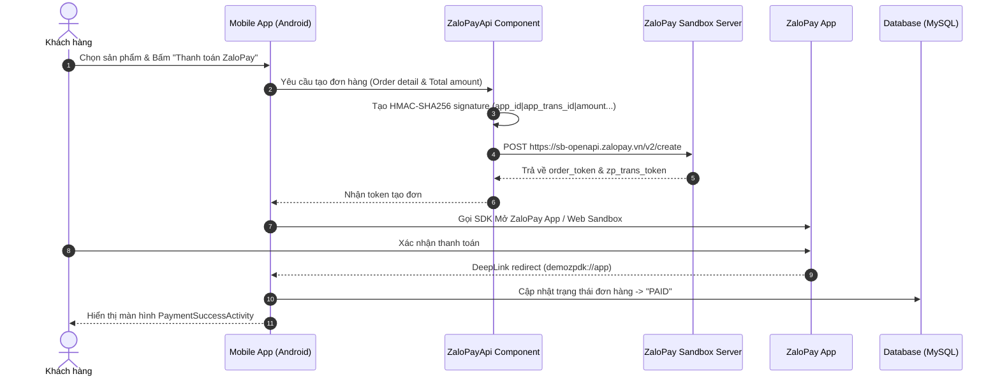
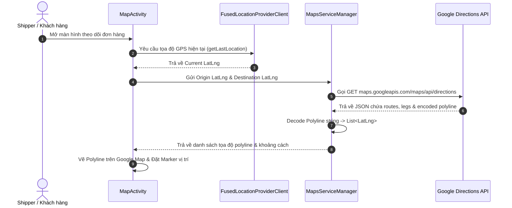
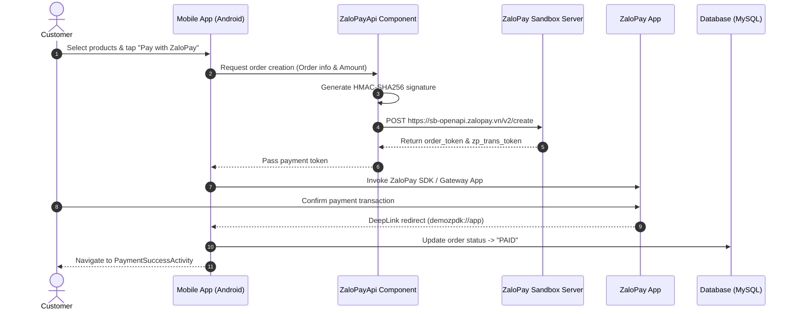
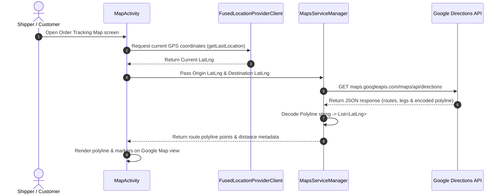

# 📱 PRM392 - TechGadget Mobile App

[](#-bản-tiếng-việt--vietnamese)
[](#-tech-stack--dependencies)
[](#-hướng-dẫn-cài-đặt--khởi-chạy)

> **TechGadget Mobile App**: Ứng dụng thương mại điện tử mua sắm thiết bị công nghệ tích hợp dịch vụ định vị Google Cloud (Google Maps, GPS), Thanh toán ZaloPay Sandbox và Trợ lý AI Chatbot (Coze API).

---

## 🌐 Quick Navigation / Điều hướng nhanh
- 🇻🇳 [Bản tiếng Việt (Vietnamese Version)](#-bản-tiếng-việt--vietnamese)
- 🇬🇧 [English Version](#-english-version)

---

# 🇻🇳 BẢN TIẾNG VIỆT (VIETNAMESE)

## 📌 1. Context (Bối cảnh & Mục tiêu dự án)

Trong kỷ nguyên số hóa, nhu cầu trải nghiệm mua sắm đồ công nghệ (Laptop, Smartphone, Linh kiện, Phụ kiện) trên di động đòi hỏi sự nhanh chóng, minh bạch và thông minh. Dự án **TechGadget Mobile App** được xây dựng trong khuôn khổ môn học **PRM392 (Mobile Programming)** nhằm mục đích:
* Cung cấp sàn thương mại điện tử di động toàn diện cho thiết bị công nghệ.
* Tích hợp **Google Cloud Services** để định vị người dùng, tìm kiếm địa chỉ và theo dõi trực tiếp lộ trình giao hàng của shipper.
* Kết hợp cổng thanh toán trực tuyến **ZaloPay (Sandbox)** hiện đại song song với phương thức ship COD truyền thống.
* Ứng dụng **AI Chatbot (Coze Platform)** tư vấn sản phẩm thông minh 24/7.
* Cung cấp bộ công cụ quản trị (Admin/Staff) quản lý đơn hàng, kho bãi và biểu đồ doanh thu.

---

## 🛠️ 2. Tech Stack (Công nghệ & Thư viện)

| Phân tầng | Công nghệ / Thư viện | Vai trò |
| :--- | :--- | :--- |
| **Nền tảng Core** | Android SDK 35 (Min SDK 35), Java 11 | Nền tảng phát triển Android Native |
| **Build Tool** | Gradle Kotlin DSL (`build.gradle.kts`) | Quản lý cấu hình dependencies & build pipeline |
| **Giao diện (UI)** | Material Design 3, RecyclerView, CardView | Giao diện chuẩn Material, mượt mà |
| **Networking** | Retrofit2 (`2.9.0`), OkHttp3 (`4.11.0`), Gson | Gọi REST API, Google Cloud APIs & Coze Service |
| **Xử lý ảnh** | Picasso (`2.8`), Glide (`4.15.1`) | Tải và cache ảnh sản phẩm |
| **Cơ sở dữ liệu** | MySQL Server (`technology_device_store`), JDBC | Lưu trữ dữ liệu hệ thống |
| **Biểu đồ (Analytics)**| MPAndroidChart (`v3.1.0`) | Trực quan hóa doanh thu & đơn hàng cho Staff/Admin |

---

## ☁️ 3. Google Cloud Platform & Third-Party Integrations

### 3.1. Google Cloud Services
1. **Google Maps SDK for Android (`play-services-maps:18.1.0`)**: Hiển thị bản đồ tương tác, vị trí cửa hàng, vị trí giao hàng và vẽ đường đi (`Polyline`).
2. **Google Location Services (`play-services-location:21.0.1`)**: Sử dụng `FusedLocationProviderClient` lấy tọa độ GPS chính xác thời gian thực của thiết bị.
3. **Google Directions API**: Tính toán khoảng cách (distance), thời gian di chuyển (duration) và giải mã chuỗi `overview_polyline` đường đi.
4. **Google Geocoding & Reverse Geocoding API**:
   * *Geocoding*: Chuyển chuỗi địa chỉ văn bản thành tọa độ `(Latitude, Longitude)`.
   * *Reverse Geocoding*: Chuyển tọa độ GPS thành địa chỉ nhà cụ thể.
5. **Google Firebase Auth (`firebase-auth-ktx`) & Google Sign-In (`play-services-auth:21.2.0`)**: Đăng nhập nhanh và an toàn bằng tài khoản Google.

### 3.2. Cổng thanh toán ZaloPay (Sandbox)
* Tích hợp ZaloPay Android SDK (`.aar`/`.jar` trong `app/zalopaylibs`).
* Tạo chữ ký bảo mật **HMAC-SHA256** checksum bảo vệ thông tin giao dịch.
* Xử lý DeepLink (`demozpdk://app`) tự động quay lại ứng dụng sau khi thanh toán thành công hoặc thất bại.

### 3.3. AI Chatbot (Coze Open API)
* Kết nối API Coze Chat (`v2/chat`) qua OkHttp.
* Hỗ trợ giải đáp thắc mắc, gợi ý sản phẩm phù hợp với nhu cầu khách hàng.

---

## 🔄 4. Workflow (Quy trình hoạt động hệ thống)

### 4.1. Quy trình Đặt hàng & Thanh toán ZaloPay


### 4.2. Quy trình Định vị GPS & Theo dõi Đơn hàng Google Maps


### 4.3. Quy trình Tư vấn AI Chatbot (Coze API)
1. Người dùng nhập câu hỏi vào `ChatBotActivity`.
2. `CozeApiClient` đóng gói JSON payload chứa `bot_id`, `query` và `user`.
3. Gửi HTTP POST tới `https://api.coze.com/open_api/v2/chat`.
4. Parse nội dung phản hồi từ AI và hiển thị lên `RecyclerView` của giao diện Chat.

---

## 📂 5. Cấu trúc dự án (Directory Structure)

```text
PRM392_FinalProject/
├── app/
│   ├── build.gradle.kts                    # Dependency configuration
│   ├── zalopaylibs/                        # ZaloPay AAR/JAR Libraries
│   └── src/main/
│       ├── AndroidManifest.xml             # Permissions & Activity Intent Filters
│       ├── java/com/example/prm392_finalproject/
│       │   ├── chatbot/                    # Coze AI Client & Models
│       │   ├── controllers/                # Business Logic Repositories
│       │   ├── dao/                        # Data Access Objects (SQL)
│       │   ├── db/                         # Database connection (ConnectionClass)
│       │   ├── models/                     # Data entities
│       │   ├── service/                    # Google Maps Services & Retrofit APIs
│       │   ├── utils/                      # CartManager & GPS Distance Calculator
│       │   ├── views/                      # UI Activities & Adapters
│       │   └── zalopay/                    # ZaloPay SDK integration & HMAC signer
│       └── res/                            # Layouts, Strings & Assets
└── README.md
```

---

## 🚀 6. Hướng dẫn Cài đặt & Khởi chạy

1. **Yêu cầu**: Android Studio Ladybug/Koala+, JDK 11+, Android SDK API 35.
2. **Cấu hình `app/src/main/res/values/strings.xml`**:
   ```xml
   <string name="google_maps_api_key">YOUR_GOOGLE_MAPS_API_KEY</string>
   <string name="zalopay_app_id">2553</string>
   <string name="zalopay_secret_key">sandbox_secret_key</string>
   <string name="zalopay_app_scheme">demozpdk</string>
   ```
3. **Mở dự án & Sync Gradle**: Mở trong Android Studio và nhấn `Sync Project`.
4. **Chạy ứng dụng**: Chọn thiết bị thật hoặc Emulator API 35 và nhấn `Run`.

---

## 🔍 7. Báo cáo Đánh giá Code & Kiến trúc (Code Review)

* 🔴 **[CRITICAL] Trực tiếp kết nối MySQL Client**: [ConnectionClass.java](file:///d:/PRM392_FinalProject/app/src/main/java/com/example/prm392_finalproject/db/ConnectionClass.java) chứa IP server & thông tin đăng nhập MySQL. -> **Cần chuyển sang REST Backend API**.
* 🔴 **[CRITICAL] Hardcode Secret Keys**: Token Coze API trong [CozeConstants.java](file:///d:/PRM392_FinalProject/app/src/main/java/com/example/prm392_finalproject/chatbot/CozeConstants.java) và Log secret key ZaloPay. -> **Đưa vào `BuildConfig` / `.env`**.
* 🟠 **[HIGH] Plaintext Passwords**: Mật khẩu người dùng chưa được mã hóa hash trong [UserRepository.java](file:///d:/PRM392_FinalProject/app/src/main/java/com/example/prm392_finalproject/controllers/UserRepository.java). -> **Cần băm mật khẩu bằng BCrypt/Argon2**.
* 🟠 **[HIGH] Lỗi thời API**: Sử dụng `AsyncTask` trong [MapActivity.java](file:///d:/PRM392_FinalProject/app/src/main/java/com/example/prm392_finalproject/views/MapActivity.java). -> **Chuyển sang Kotlin Coroutines**.

---
---

# 🇬🇧 ENGLISH VERSION

## 📌 1. Context & Project Overview

In the mobile-first era, online shopping for tech products (Laptops, Smartphones, Accessories, Components) requires speed, security, real-time location tracking, and smart customer support. The **TechGadget Mobile App** was developed as part of the **PRM392 (Mobile Programming)** course to achieve the following goals:
* Deliver a feature-rich e-commerce mobile application dedicated to tech products.
* Integrate **Google Cloud Platform Services** for device location detection, address geocoding, and live delivery route tracking.
* Provide multi-channel payment integration: **ZaloPay Sandbox** online payment alongside traditional Cash-on-Delivery (COD).
* Embed an **AI Chatbot (powered by Coze Open API)** for 24/7 instant customer care and product recommendations.
* Supply an intuitive Admin/Staff management dashboard with interactive revenue visualization.

---

## 🛠️ 2. Tech Stack & Dependencies

| Layer | Technology / Library | Role |
| :--- | :--- | :--- |
| **Core Platform** | Android SDK 35 (Min SDK 35), Java 11 | Android Native application framework |
| **Build Tool** | Gradle Kotlin DSL (`build.gradle.kts`) | Dependency & build pipeline configuration |
| **User Interface** | Material Design 3, RecyclerView, CardView | Modern responsive UI components |
| **Networking** | Retrofit2 (`2.9.0`), OkHttp3 (`4.11.0`), Gson | RESTful API Client for Google Cloud & Coze |
| **Image Loading** | Picasso (`2.8`), Glide (`4.15.1`) | Efficient image fetching and caching |
| **Database Layer** | MySQL Server (`technology_device_store`), JDBC | Relational data storage |
| **Analytics & Charts**| MPAndroidChart (`v3.1.0`) | Interactive sales reporting for Admin/Staff |

---

## ☁️ 3. Google Cloud Platform & Third-Party Integrations

### 3.1. Google Cloud Services
1. **Google Maps SDK for Android (`play-services-maps:18.1.0`)**: Renders interactive maps, store markers, delivery locations, and polyline route paths.
2. **Google Location Services (`play-services-location:21.0.1`)**: Uses `FusedLocationProviderClient` to obtain accurate real-time device GPS coordinates.
3. **Google Directions API**: Calculates travel distance, estimated duration, and decodes the `overview_polyline` string.
4. **Google Geocoding & Reverse Geocoding API**:
   * *Geocoding*: Converts text addresses into `(Latitude, Longitude)` coordinates.
   * *Reverse Geocoding*: Converts raw GPS coordinates into formatted human-readable street addresses.
5. **Google Firebase Auth (`firebase-auth-ktx`) & Google Sign-In (`play-services-auth:21.2.0`)**: Secure authentication via Google accounts.

### 3.2. ZaloPay Payment Gateway (Sandbox)
* Integrates ZaloPay Android SDK (`.aar`/`.jar` files in `app/zalopaylibs`).
* Computes **HMAC-SHA256** signatures to secure payment request payloads.
* Handles DeepLink callback scheme (`demozpdk://app`) to resume app execution post-payment.

### 3.3. AI Chatbot Integration (Coze Open API)
* Connects to Coze Chat OpenAPI endpoint (`v2/chat`) via HTTP requests.
* Provides automated product recommendations and customer service answers.

---

## 🔄 4. Workflows & Architecture Diagrams

### 4.1. Order Checkout & ZaloPay Payment Workflow


### 4.2. GPS Location & Google Maps Route Tracking Workflow


### 4.3. AI Chatbot Workflow (Coze API)
1. User enters a query in `ChatBotActivity`.
2. `CozeApiClient` constructs a JSON payload containing `bot_id`, `query`, and `user`.
3. Sends an HTTP POST request to `https://api.coze.com/open_api/v2/chat`.
4. Parses the AI response message and renders it inside the Chat `RecyclerView`.

---

## 📂 5. Directory Structure

```text
PRM392_FinalProject/
├── app/
│   ├── build.gradle.kts                    # Dependency configuration
│   ├── zalopaylibs/                        # ZaloPay AAR/JAR Libraries
│   └── src/main/
│       ├── AndroidManifest.xml             # Permissions & Activity Intent Filters
│       ├── java/com/example/prm392_finalproject/
│       │   ├── chatbot/                    # Coze AI Client & Models
│       │   ├── controllers/                # Business Logic Repositories
│       │   ├── dao/                        # Data Access Objects (SQL)
│       │   ├── db/                         # Database connection (ConnectionClass)
│       │   ├── models/                     # Data entities
│       │   ├── service/                    # Google Maps Services & Retrofit APIs
│       │   ├── utils/                      # CartManager & GPS Distance Calculator
│       │   ├── views/                      # UI Activities & Adapters
│       │   └── zalopay/                    # ZaloPay SDK integration & HMAC signer
│       └── res/                            # Layouts, Strings & Assets
└── README.md
```

---

## 🚀 6. Installation & Setup Guide

1. **Prerequisites**: Android Studio (Ladybug/Koala+), JDK 11+, Android SDK API 35.
2. **Configure `app/src/main/res/values/strings.xml`**:
   ```xml
   <string name="google_maps_api_key">YOUR_GOOGLE_MAPS_API_KEY</string>
   <string name="zalopay_app_id">2553</string>
   <string name="zalopay_secret_key">sandbox_secret_key</string>
   <string name="zalopay_app_scheme">demozpdk</string>
   ```
3. **Open Project & Sync**: Import into Android Studio and execute `Sync Project with Gradle Files`.
4. **Run Application**: Deploy to a physical Android device or Emulator (API 35).

---

## 🔍 7. Code Review & Architecture Security Findings

* 🔴 **[CRITICAL] Direct MySQL JDBC Connection**: [ConnectionClass.java](file:///d:/PRM392_FinalProject/app/src/main/java/com/example/prm392_finalproject/db/ConnectionClass.java) exposes raw DB server IP and credentials. -> **Migrate to REST Backend API**.
* 🔴 **[CRITICAL] Hardcoded API Tokens**: Hardcoded Coze PAT in [CozeConstants.java](file:///d:/PRM392_FinalProject/app/src/main/java/com/example/prm392_finalproject/chatbot/CozeConstants.java) and ZaloPay key logging. -> **Move to `BuildConfig` / `.env`**.
* 🟠 **[HIGH] Plaintext Passwords**: User passwords stored without hashing in [UserRepository.java](file:///d:/PRM392_FinalProject/app/src/main/java/com/example/prm392_finalproject/controllers/UserRepository.java). -> **Hash passwords with BCrypt/Argon2**.
* 🟠 **[HIGH] Deprecated APIs**: `AsyncTask` usage in [MapActivity.java](file:///d:/PRM392_FinalProject/app/src/main/java/com/example/prm392_finalproject/views/MapActivity.java). -> **Migrate to Kotlin Coroutines**.

---

## 📝 License
Developed for the **PRM392 - Mobile Programming** course.
